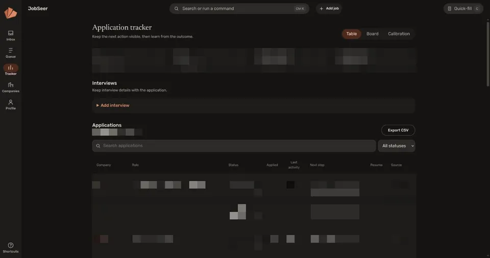

# jobscout

Finds DevOps, SRE, platform and infrastructure internships and co-ops, then pushes the new ones worth reading to my phone with ntfy.

<p>
  
  
</p>

It exists because the general internship lists are software engineering lists. Filtering one for infrastructure work returns almost nothing, not because the roles are rare but because they are posted somewhere else, under titles that share vocabulary with the sales org.

## How it runs

A Kubernetes CronJob every six hours. There is no web service in the scout itself: the job wakes, reads every configured board, stores what it found, pushes what is new, and exits.

```
CronJob (6h)
  |-- sources: about 260 boards across 6 providers, plus the Simplify lists
  |-- filters: shape, level, location, term
  |-- scoring: rank, collapse duplicates, apply the floor
  |-- Postgres (CloudNativePG): every posting, its score, and why
  |     `-- WAL and a daily base backup to Cloudflare R2
  `-- ntfy: the top of the queue, on its own topic
```

Nothing in the pod holds state. Notifications go to their own ntfy topic, separate from cluster alerts, because a job match and a failing pod deserve different attention. The board list, filters and scoring weights are a ConfigMap, so tuning the search is a commit and an Argo CD sync rather than an image build.

## Providers

A provider takes a fetcher, a board identifier and a display name, and returns postings or `None`. `None` means the board did not answer, which matters: an empty list means nothing is open and old postings may be closed, while a failed board must never retire jobs that are still live.

| provider | board identifier | shape |
|---|---|---|
| Greenhouse, Lever, Ashby | slug | one GET of public JSON |
| Workday | tenant, wd number, site | paged POST, one query per search term |
| Amazon | a search query | one GET per query |
| Phenom | careers host | sitemap, then a detail fetch per plausible job |

Workday's search is a substring match, so searching `intern` also matches "Internal Audit". The fan-out is over the infrastructure words, and the level is decided locally where it can be precise. Phenom looks like it needs a browser, but every site publishes a sitemap and each job page carries schema.org `JobPosting` data, so the slug alone discards most jobs without opening them.

## Filtering and scoring

Four gates, in order: title shape, level (co-op or internship), location (US or remote), and term (Spring or Summer 2027). Then every candidate is scored:

| signal | points |
|---|---|
| title names the work (`devops`, `site reliability`) | +100 |
| title only hints at it (`platform`, `technology`) | +25 |
| co-op | +40 |
| internship | +20 |
| names a wanted term | +30 |
| posted within a week | +10 |
| a discipline that shares the vocabulary | -60 |
| names a term that has already gone | -70 |

The score and its breakdown are stored for every candidate, not just the ones that push, so a posting that never arrived can still be explained afterwards. Duplicates collapse to one row, a floor keeps weak matches from ever being sent, and anything over the per-run cap is held for the next run instead of dropped.

## Config drift guard

The deployed config and the one in this repo are different files, since the deployed one carries the boards and employers being targeted. So both are held to the same behaviour instead of the same bytes: `tests/contract_cases.yaml` is the contract, this repo runs it against its default, and the gitops repo runs it against the ConfigMap it deploys. Either side drifting fails a build.

## Application dashboard

A separate long-running process over the same Postgres adds the human half of the workflow: triage an inbox, queue and save jobs, and track applications.

<p>
  
</p>

```sh
DATABASE_URL=postgresql://... python -m jobscout dashboard
python -m jobscout dashboard --demo   # no database, fictional data
```

## Run it

```sh
pip install -e .
python -m jobscout --config config/filters.yaml check   # run the contract
python -m jobscout run                                  # needs DATABASE_URL
JOBSCOUT_SEED=true python -m jobscout run               # record only, push nothing
python -m jobscout discover-boards                      # derive board slugs
make test
```
