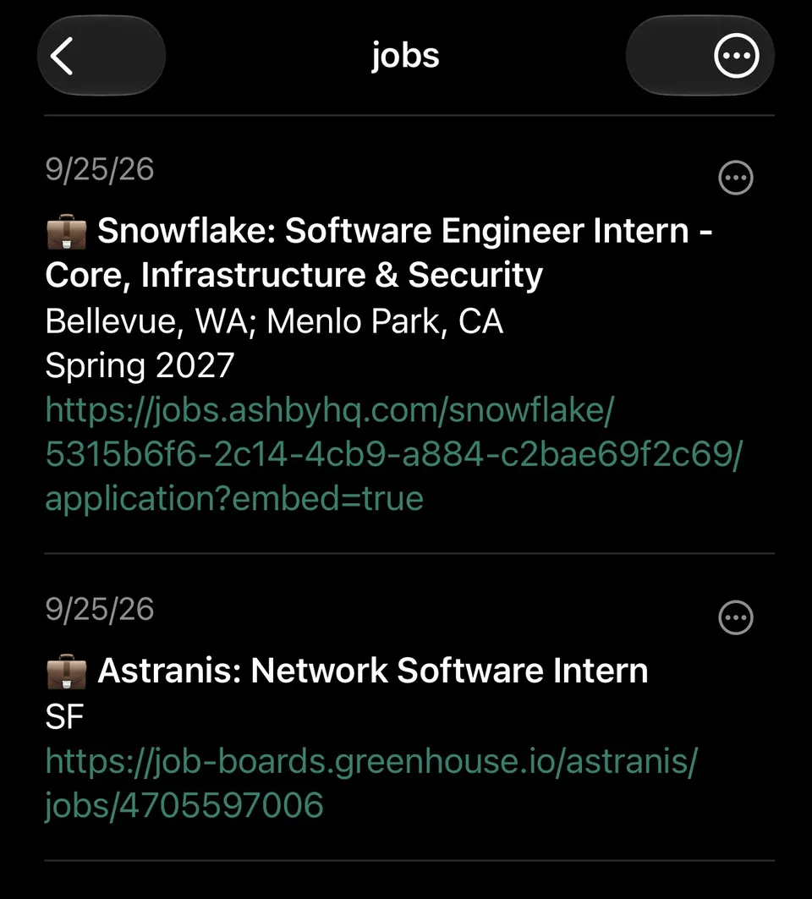
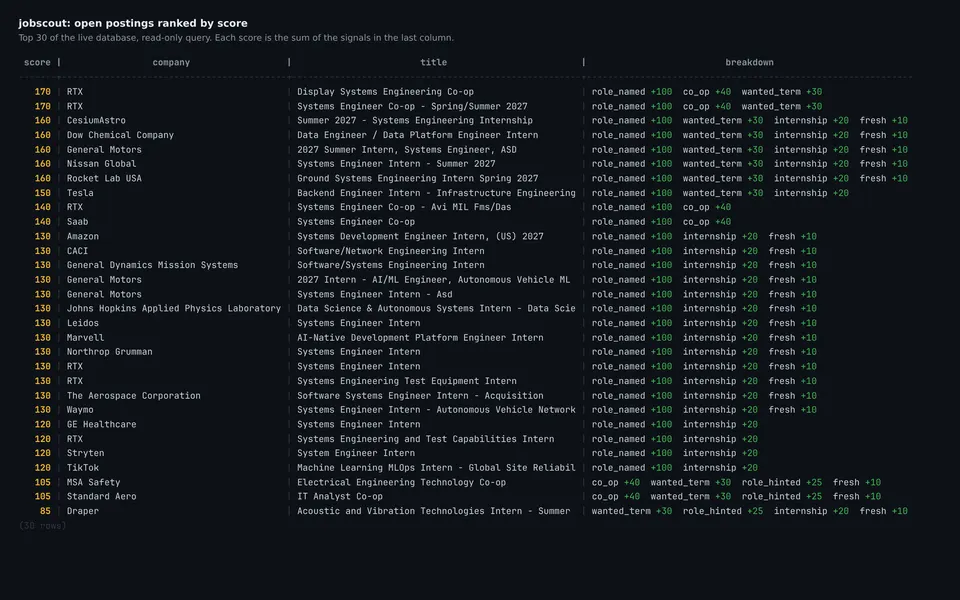

# jobscout

Finds DevOps, SRE, platform and infrastructure internships and co-ops, then pushes the new ones worth reading to my phone with ntfy.

<p>
  
  
</p>

## How it works

A Kubernetes CronJob runs every six hours. It reads about 260 company boards (Greenhouse, Lever, Ashby, Workday, Amazon, Phenom and the Simplify lists), keeps the postings that match on role, level, location and term, scores them, and stores everything in Postgres. The best new ones go out over ntfy.

The board list, filters and scoring weights are config, so tuning the search is a commit and a sync, not an image build.

## Run it

```sh
pip install -e .
python -m jobscout --config config/filters.yaml check   # validate the config
python -m jobscout run                                  # needs DATABASE_URL
JOBSCOUT_SEED=true python -m jobscout run               # record only, push nothing
make test
```
