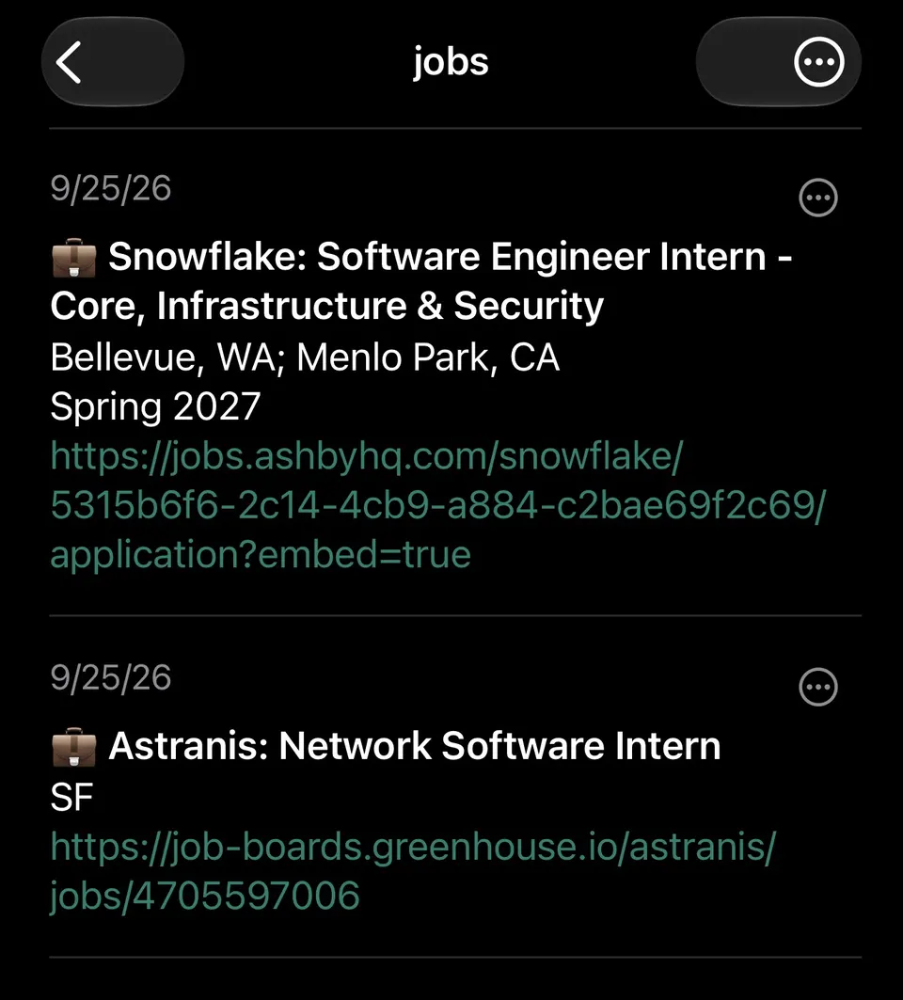
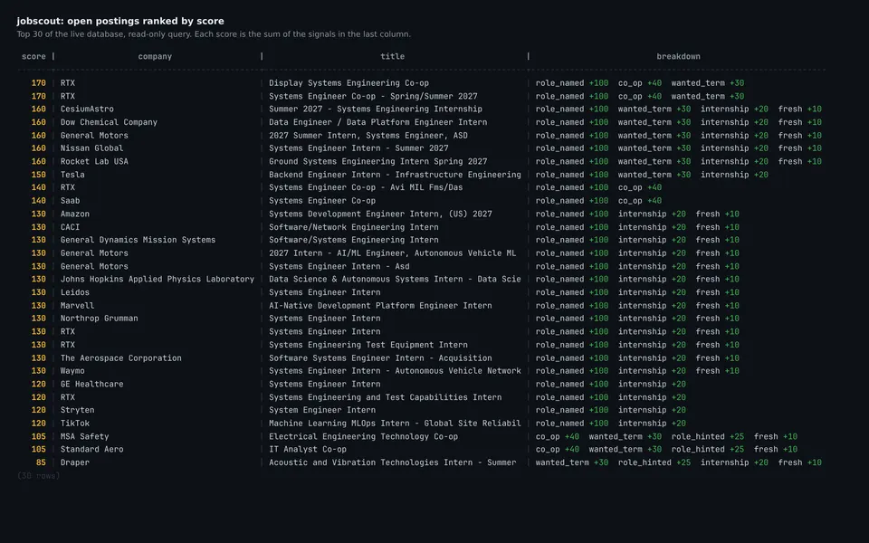
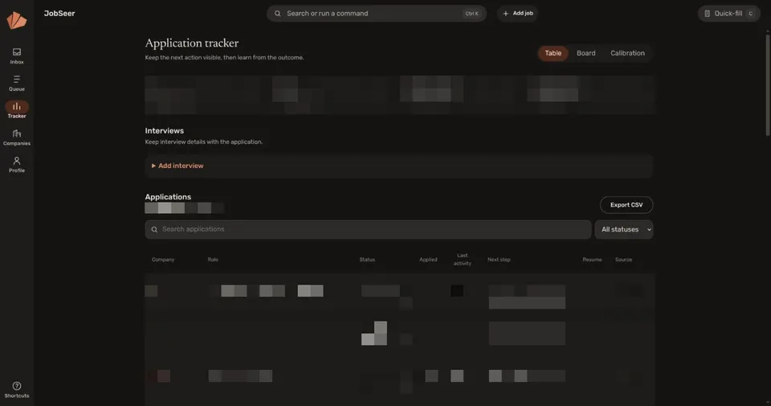

# jobscout

Finds DevOps, SRE, platform and infrastructure internships and co-ops, then pushes the new ones worth reading to my phone with ntfy.

<p>
  
  
</p>

The general internship lists are software engineering lists, and filtering one for infrastructure work returns almost nothing. Those roles are posted elsewhere, under titles that share vocabulary with the sales org.

## How it runs

A Kubernetes CronJob every six hours. There is no web service in the scout itself: the job wakes, reads every configured board, stores what it found, pushes what is new, and exits.

```
CronJob (6h)
  |-- sources: about 290 boards across 16 providers, plus the Simplify lists
  |-- filters: shape, level, location, term
  |-- scoring: rank, collapse duplicates, apply the floor
  |-- Postgres (CloudNativePG): every posting, its score, and why
  |     `-- WAL and a daily base backup to Cloudflare R2
  `-- ntfy: the top of the queue, on its own topic
```

Nothing in the pod holds state. Notifications go to their own ntfy topic, separate from cluster alerts, because a job match and a failing pod deserve different attention. The board list, filters and scoring weights are a ConfigMap, so tuning the search is a commit and an Argo CD sync rather than an image build.

## Providers

A provider takes a fetcher, a board identifier and a display name, and returns postings or `None`. `None` means the board did not answer. An empty list means nothing is open, so old postings may be closed, but a failed board must never retire jobs that are still live.

| provider | board identifier | shape |
|---|---|---|
| Greenhouse, Lever, Ashby | slug | one GET of public JSON |
| Workday | tenant, wd number, site | paged POST, one query per search term |
| Amazon | a search query | one GET per query |
| Phenom | careers host | sitemap, then a detail fetch per plausible job |
| iCIMS | customer key (`amd`) | the company's career site JSON, or the portal's search page |
| Eightfold | host and tenant domain | the PCSX search the career page calls |
| Oracle Recruiting | Fusion pod and site | public REST search, US location id read per pod |
| SuccessFactors | career site host | search page, then JobPosting markup per job |
| SmartRecruiters, Workable | company identifier | public JSON search per term |
| Apple, Google, IBM, TikTok, ByteDance | the company | each site's own search, one adapter apiece |
| Company career sites (Gulfstream) | careers host | jobs sitemap, then JobPosting per job whose slug names a term |

Workday's search is a substring match, so searching `intern` also matches "Internal Audit". The fan-out is over the infrastructure words, and the level is decided locally where it can be precise. Phenom looks like it needs a browser, but every site publishes a sitemap and each job page carries schema.org `JobPosting` data, so the slug alone discards most jobs without opening them.

Everything from iCIMS down lives in `jobscout/ats`, one module per system. Each module knows which posting URLs are its own, how to read one posting, and optionally how to search a company's board, and capture, descriptions, liveness and the scanner all ask that registry instead of carrying a branch per provider. Hosts are matched by a fixed suffix or a short list of company domains checked by hand, so pasting a link never makes the dashboard fetch an arbitrary URL. Meta postings can be captured and checked but not searched. A site whose robots.txt closes its search but publishes a jobs sitemap, like Gulfstream's, is read from the sitemap instead. Tesla and General Dynamics Land Systems are not supported: both turn away anything that is not a browser, even for robots.txt.

## Filtering and scoring

Four gates, in order: title shape, level (co-op or internship), location (US or remote), and term (Spring or Summer 2027). Then every candidate is scored:

| signal | points |
|---|---|
| title names the work (`devops`, `site reliability`) | +100 |
| title only hints at it (`platform`, `technology`) | +25 |
| co-op | +40 |
| internship | +20 |
| names a wanted term | +30 |
| posted within a week | +10 |
| a discipline that shares the vocabulary | -60 |
| names a term that has already gone | -70 |

The score and its breakdown are stored for every candidate, not just the ones that push, so a posting that never arrived can still be explained afterwards. Duplicates collapse to one row, a floor keeps weak matches from ever being sent, and anything over the per-run cap is held for the next run instead of dropped.

## Config drift guard

The deployed config and the one in this repo are different files, since the deployed one carries the boards and employers I'm targeting. They are tested against the same behaviour rather than compared byte for byte. `tests/contract_cases.yaml` is the contract: this repo runs it against its default config, and the gitops repo runs it against the ConfigMap it deploys. If either side drifts, a build fails.

## Application dashboard

A separate long-running process over the same Postgres adds the human half of the workflow: triage an inbox, queue and save jobs, and track applications.

<p>
  
</p>

```sh
DATABASE_URL=postgresql://... python -m jobscout dashboard
python -m jobscout dashboard --demo   # no database, fictional data
```

## Run it

```sh
pip install -e .
python -m jobscout --config config/filters.yaml check   # run the contract
python -m jobscout run                                  # needs DATABASE_URL
JOBSCOUT_SEED=true python -m jobscout run               # record only, push nothing
python -m jobscout discover-boards                      # derive board slugs
make test
```
